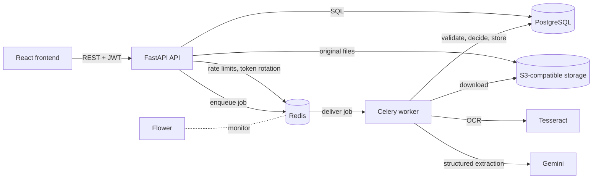
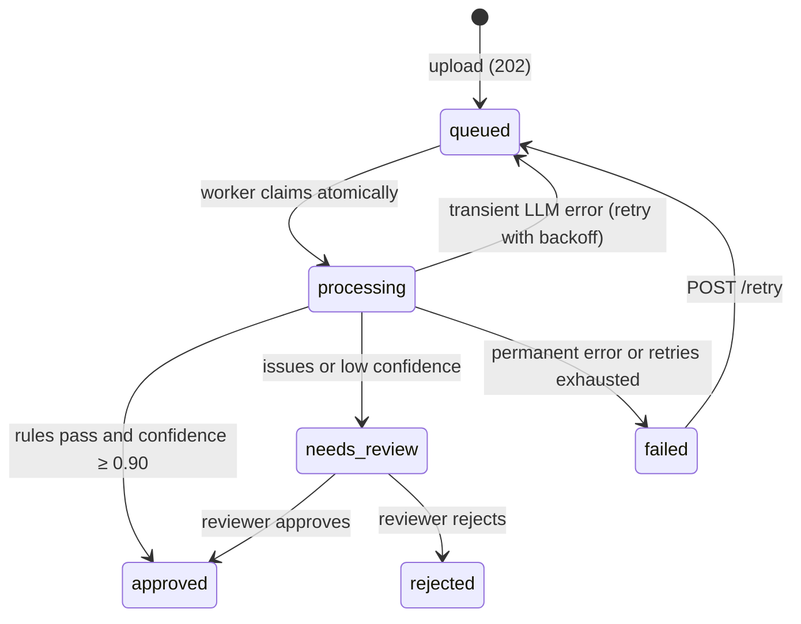

# InvoiceIQ

**AI-powered invoice processing and GST reconciliation for Indian businesses.**

Upload supplier invoices as PDFs or phone photos. InvoiceIQ extracts every field with OCR and an LLM,
verifies the data with business rules, flags duplicates, auto-approves only what it is sure about,
and reconciles approved invoices against GSTR-2B so you know which input tax credit is safe to claim.

   

---

## The problem

Small and mid-sized Indian distributors and retailers receive hundreds of supplier invoices a month.
Accounts staff type each one into accounting software: vendor, GSTIN, invoice number, line items and
taxes. It is slow, error-prone, and sometimes leads to **paying the same invoice twice**. At month end
they reconcile purchases against **GSTR-2B** by hand to claim input tax credit (ITC), which can only be
claimed for invoices the supplier actually reported to the GST portal.

## What InvoiceIQ does

1. **Upload:** PDF, JPG or PNG (validated by file content, not extension), stored in S3-compatible storage.
2. **Extract:** a Celery worker runs Tesseract OCR, then an LLM (Gemini) returns structured JSON
   matching a Pydantic schema, with a confidence score per field.
3. **Validate:** the LLM is never trusted blindly. Rules check the GSTIN format **and checksum**,
   that line items sum to the subtotal, that subtotal plus taxes equals the total, that CGST equals
   SGST with no IGST alongside them, that the date isn't in the future, and that the invoice isn't
   a duplicate.
4. **Decide:** auto-approve only when every rule passes **and** confidence ≥ 0.90; otherwise send it
   to a reviewer with the specific issues listed.
5. **Review:** reviewers correct fields beside the original document, then approve or reject. Every
   change is written to an audit log with old and new values.
6. **Reconcile:** upload GSTR-2B (portal JSON or Excel) for a month and see each record classified as
   matched, amount mismatch, missing in GSTR-2B (ITC at risk) or missing in books.

## Results

Evaluated on 20 synthetic invoices (10 clean scans, 10 simulated phone photos with rotation, blur and
noise) through the real pipeline (Tesseract and Gemini 2.5 Flash), against exact ground truth
([`backend/evaluation`](backend/evaluation)):

| Field | Accuracy |
|---|---|
| Invoice number, date, subtotal, CGST, SGST, IGST, total, line-item count | **100%** |
| Vendor GSTIN | 70% |

| Metric | Result |
|---|---|
| Fully correct invoices | 70% (scans 90%, photos 50%) |
| Auto-approval rate | 70% |
| **Wrong invoices auto-approved** | **0** |
| Average processing time | 6.4 s per invoice (OCR 0.9 s) |

All six GSTIN errors were single characters misread by OCR on photo-quality images. **The checksum
rule caught every one of them** and routed those invoices to human review. That is the point of the
design: the metric that matters is not raw accuracy but *wrong-but-auto-approved*, and it is zero.

Reproduce: `python -m evaluation.generate_samples --count 20 && python -m evaluation.run_eval`
(inside the worker container; see [Evaluation](#evaluation)).

## Architecture





**Layered backend:** routes (HTTP only) → services (business rules, transactions) → repositories
(SQL) → models. External systems (storage, OCR, LLM, task queue) sit behind `Protocol` interfaces,
so tests use in-memory fakes and providers can be swapped through configuration.

## Tech stack

| Area | Technology |
|---|---|
| API | Python 3.12, FastAPI (async), Pydantic v2 |
| Database | PostgreSQL 17, SQLAlchemy 2 (async, asyncpg), Alembic |
| Background jobs | Celery + Redis, Flower |
| Storage | S3 API via boto3 (SeaweedFS locally; AWS S3, R2 or MinIO elsewhere) |
| OCR / AI | Tesseract + pdf2image, Google Gemini with structured JSON output |
| Auth | JWT access + refresh tokens with rotation, bcrypt, role-based access |
| Frontend | React 18, Vite, TypeScript, React Router, Axios |
| Quality | pytest (133 tests), Ruff, mypy `--strict`, GitHub Actions |
| Ops | Docker (multi-stage), Docker Compose, Azure Container Apps guide |

## Getting started

**Requirements:** Docker Desktop. Optionally a free Gemini API key from
<https://aistudio.google.com/apikey>; without one, uploads are marked failed with a clear reason.

```bash
git clone <repo-url> && cd invoiceiq
cp .env.example .env            # then set JWT_SECRET_KEY, passwords and LLM_API_KEY
docker compose up -d            # postgres, redis, storage, api, worker, flower, frontend
```

| Service | URL |
|---|---|
| Web app | http://localhost:5173 |
| API docs (Swagger) | http://localhost:8000/docs |
| Health check | http://localhost:8000/health |
| Celery dashboard (Flower) | http://localhost:5555 |

Register a business on the web app, upload an invoice, and watch it move from *queued* to *approved*
or *needs review* within seconds. Migrations run automatically when the API container starts.

### Running tests and checks (backend)

```bash
cd backend
python -m venv .venv && .venv/Scripts/activate     # Windows (Linux/macOS: source .venv/bin/activate)
pip install -e ".[dev]"
docker compose up -d postgres redis seaweedfs       # tests use a real Postgres and Redis
pytest                                              # 130 tests (3 more need Tesseract: run in Docker/CI)
ruff check . && mypy app
```

## API overview

All endpoints are under `/api/v1`. Errors always have the shape
`{"error": {"code": "...", "message": "...", "details": ...}}`.

| Method & path | Role | Description |
|---|---|---|
| `POST /auth/register` | public | Create organization + admin user |
| `POST /auth/login` · `POST /auth/refresh` · `GET /auth/me` | public / any | JWT login, single-use refresh tokens, profile |
| `POST /users` · `GET /users` · `PATCH /users/{id}` | admin | Manage users in your organization |
| `POST /invoices/upload` | any | Upload a file → `202` with the invoice id |
| `GET /invoices` | any | Pagination, filters (status, vendor, date range), sorting |
| `GET /invoices/{id}` · `/status` · `/file` | any | Detail with line items, lightweight status, presigned file URL |
| `PATCH /invoices/{id}` | reviewer | Correct fields; validation re-runs; audit-logged |
| `POST /invoices/{id}/approve` · `/reject` · `/retry` | reviewer / any | Review decisions, re-process failed invoices |
| `GET /vendors` · `GET /vendors/{id}` | any | Vendors created automatically from verified GSTINs |
| `POST /reconciliation/runs` | reviewer | Upload GSTR-2B (`.json` / `.xlsx`) for a period |
| `GET /reconciliation/runs` · `/runs/{id}/results` | any | Runs with summary; results filterable by match status |
| `GET /dashboard/stats` | any | Counts by status, auto-approval rate, processing time |
| `GET /health` | public | Checks database and Redis (503 when degraded) |

Every query is scoped to the caller's organization; another tenant's resources return `404`.

## Key design decisions

- **Never trust the LLM blindly.** Structured output constrained to a JSON Schema, Pydantic
  validation, per-field confidence, deterministic business rules, and human review. Two independent
  safety nets have to agree before anything is auto-approved.
- **Idempotent background processing.** Celery delivers at least once, so a worker claims an invoice
  with a single atomic `UPDATE … WHERE status = 'queued' RETURNING id`. A duplicate delivery finds
  nothing to claim and exits. Claims stuck after a worker crash become reclaimable after 15 minutes.
- **Retry only what can succeed.** Timeouts, rate limits, 5xx responses and malformed JSON are
  retried with exponential backoff and jitter (max 3). Bad credentials and unreadable documents fail
  immediately with a reason.
- **Duplicate payments are blocked twice.** An application check flags duplicates for review, and a
  partial unique index (`organization, vendor, invoice number WHERE status = 'approved'`) makes a
  double approval impossible even under race conditions.
- **Money is exact.** `NUMERIC(14,2)` in Postgres, `Decimal` in Python, strings in JSON.
- **Multi-tenancy by design.** `organization_id` on every table, taken from the authenticated user
  and never from the request body, with composite indexes leading with `organization_id`.
- **Secure auth.** 15-minute access tokens; refresh tokens rotated and single-use via an atomic Redis
  `SET NX`; the user is reloaded on every request so deactivation takes effect immediately; constant-time
  login responses to prevent user enumeration; rate-limited login and upload.
- **Protocol-based integrations.** Storage, OCR, LLM and task queue are interfaces. When MinIO stopped
  publishing Docker images, switching to SeaweedFS needed no code changes, because the code targets
  the S3 protocol.

## Testing

133 tests across auth and RBAC, tenant isolation, upload validation, every validation rule, duplicate
detection, the pipeline with mocked OCR and LLM (retries, idempotency, stale claims), LLM error
classification, review and audit logs, reconciliation matching and parsing, and dashboard stats.
Tests run against a **real PostgreSQL and Redis** with per-test transaction rollback, so constraints
and indexes are exercised for real. Three OCR tests run real Tesseract (in Docker and CI).

## Evaluation

```bash
docker compose run --rm -v ./backend/evaluation:/app/evaluation worker sh -c \
  "python -m evaluation.generate_samples --count 20 && python -m evaluation.run_eval"
```

`generate_samples.py` renders realistic GST invoices (supplier and buyer GSTINs, intra- or
inter-state tax, 2–4 line items) as clean scans and simulated phone photos, each with a ground-truth
JSON file. `run_eval.py` runs the real OCR and LLM and reports field-level accuracy, auto-approval
rate and wrong-but-auto-approved invoices. Results are saved to `backend/evaluation/data/results.json`.

## Deployment

See [docs/DEPLOYMENT_AZURE.md](docs/DEPLOYMENT_AZURE.md) for Azure Container Apps (API, autoscaled
workers with KEDA on queue length, nginx frontend), managed PostgreSQL and Redis, migrations as a
per-release job, and CI/CD with OIDC and commit-SHA image tags.

## Limitations and roadmap

- OCR on phone photos is the weakest link (50% fully correct). Next: image preprocessing (deskew,
  thresholding) or Azure Document Intelligence behind the existing `OCRProvider` interface.
- The benchmark is synthetic. Next: a small hand-labelled set of real invoices.
- Native Azure Blob storage is planned as a second `StorageBackend` implementation; S3-compatible
  storage works today.
- Status updates use polling; Server-Sent Events would push changes instead.
- The refresh token is stored in `localStorage`; an httpOnly cookie would be safer against XSS.

## Project structure

```
invoiceiq/
├── backend/
│   ├── app/
│   │   ├── api/            # routes (v1) and dependencies (auth, roles)
│   │   ├── core/           # config, security, logging, errors, rate limiting
│   │   ├── db/             # engine, sessions, base model
│   │   ├── models/         # SQLAlchemy tables
│   │   ├── schemas/        # Pydantic request/response and extraction schemas
│   │   ├── services/       # business logic: pipeline, validation, review, reconciliation
│   │   ├── repositories/   # SQL queries
│   │   ├── integrations/   # storage, OCR, LLM (interfaces + implementations)
│   │   └── workers/        # Celery app and tasks
│   ├── alembic/            # migrations
│   ├── evaluation/         # benchmark generator and runner
│   └── tests/
├── frontend/               # React + Vite + TypeScript
├── docs/                   # deployment guide
├── .github/workflows/      # CI
└── docker-compose.yml
```
